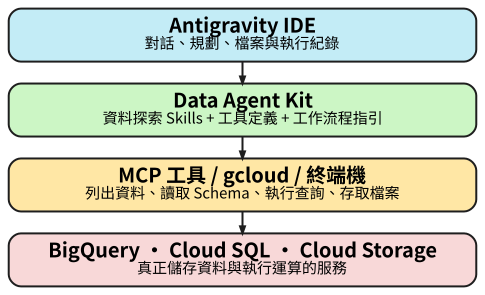
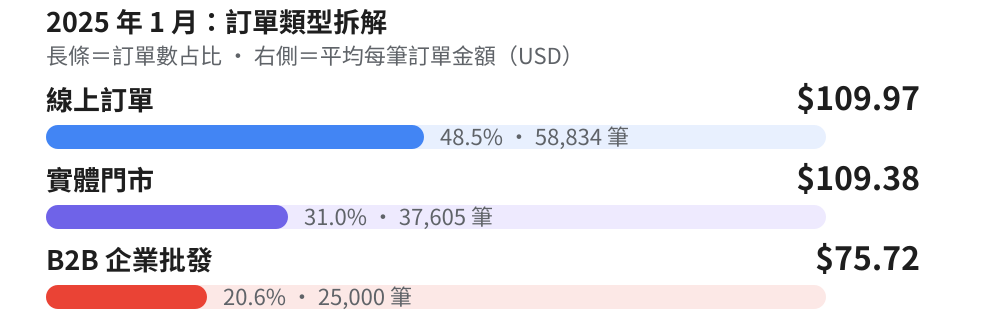

<script>
if (window.location.hostname === 'denny.one') {
  window.dataLayer = window.dataLayer || [];
  window.gtag = function () { window.dataLayer.push(arguments); };
  window.gtag('js', new Date());
  window.gtag('config', 'G-SJL6EQRW3V');
  const script = document.createElement('script');
  script.async = true;
  script.src = 'https://www.googletagmanager.com/gtag/js?id=G-SJL6EQRW3V';
  document.head.appendChild(script);
}
</script>
<script src="assets/copy-prompt.js" defer></script>

<!-- _class: title -->
<!-- _paginate: false -->

<div class="cover-location">Taipei</div>

# 使用 Data Agent Kit<br>與 Antigravity IDE<br>進行資料分析

<div class="speaker"><strong>Denny Huang</strong><br>GDG Cloud Taipei / 2026.10.27</div>

---

<!-- _class: link -->
<!-- _paginate: false -->

# 投影片

<div class="link-grid">
<a href="https://denny.one/20261027-dak/"></a>
<div>
<p class="slide-url"><a href="https://denny.one/20261027-dak/">denny.one/20261027-dak/</a></p>
<p class="entry-link"><a href="https://codelabs.developers.google.com/dak-analytics-eng-antigravity-ide?hl=zh-tw">官方 Lab</a></p>
<p class="entry-link"><a href="https://denny.one/data-agent-kit-analytics-demo/transcript/">對話與工具紀錄</a></p>
</div>
</div>

---

<!-- _class: intro -->

# Denny Huang

- GDG Cloud Taipei Organizer
- <a href="https://sitcon.org/" target="_blank">SITCON 學生計算機年會</a> 共同發起人
- <a href="https://coscup.org/" target="_blank">COSCUP 開源人年會</a> 長期志工
- <a href="https://hitcon.org/" target="_blank">HITCON 台灣駭客年會</a>  長期志工
- 曾任雷亞遊戲（Rayark Inc.） 資料分析團隊主管
- <a href="https://denny.one/" target="_blank">About me</a>

---

<!-- _class: full-dashboard -->

# 1 月，生意變好了嗎？

<a class="dashboard-frame" href="https://denny.one/data-agent-kit-analytics-demo/"></a>

<p class="dashboard-link"><a href="https://denny.one/data-agent-kit-analytics-demo/">開啟儀表板</a> · 比較 12 月與 1 月：營收、訂單數、客單價</p>

---

<!-- _class: metrics -->

# 營收增加，客單價卻下降？

<p class="muted">Cymbal Pets 寵物用品電商 / 2024 年 12 月與 2025 年 1 月</p>

<div class="metric-row">
<div class="metric">
<div class="number accent-green">+2.8%</div>
<div class="label">營收</div>
<div class="detail">US$1,214 萬 → 1,248 萬</div>
</div>
<div class="metric">
<div class="number accent-blue">+10.1%</div>
<div class="label">訂單數</div>
<div class="detail">110,274 → 121,439</div>
</div>
<div class="metric">
<div class="number accent-red">−6.7%</div>
<div class="label">平均每筆訂單金額</div>
<div class="detail">US$110.10 → 102.74</div>
</div>
</div>

---

<!-- _class: statement -->

# AOV

<p class="lede">Average Order Value / 平均每筆訂單金額</p>

<div class="equation">營收總額 ÷ 不重複訂單數</div>

<p class="calculation">US$12,476,072.76 ÷ 121,439 筆 = <strong>US$102.74</strong></p>
<p class="muted">2025/01 · 同一批訂單</p>

---

# 一列，代表什麼？

<div class="columns">
<div>
<h2><code>orders</code></h2>

| 訂單編號 | 客戶 |
|---|---|
| O-101 | C-01 |

</div>
<div>
<h2><code>order_items</code></h2>

| 訂單編號 | 商品明細 |
|---|---|
| O-101 | 飼料 |
| O-101 | 玩具 |

</div>
</div>

<p class="takeaway">1 筆訂單 / 2 筆明細（示意）</p>

---

<!-- _class: data-map -->

# 資料在哪裡？怎麼對起來？



<p class="diagram-caption">1 : N = 一對多</p>

---

<!-- _class: diagram -->

# Agent / DAK / Tools

<div class="columns architecture">
<div>

</div>
<div>
<h2>你要確認什麼？</h2>
<ul>
<li>用哪個帳號、哪個 project？</li>
<li>呼叫了哪個工具？</li>
<li>執行了什麼 SQL？</li>
</ul>
<p class="muted">資料存取範圍由憑證與 IAM 決定</p>
</div>
</div>

---

<!-- _class: demo -->

# DEMO

```text
請使用 BigQuery 的 orders 與 order_items，
分析 2024 年 8 月到 2025 年 1 月，
每個月的平均每筆訂單金額、營收及訂單數，
並用中文表格呈現。
```

<p class="takeaway"><a href="https://denny.one/data-agent-kit-analytics-demo/transcript/#step-0">展開執行紀錄，看 SQL 與查詢結果</a></p>

---

<!-- _class: results-table -->

# 哪個月值得追查？

| 月份 | 營收（USD） | 訂單數 | AOV（USD） |
|---|---:|---:|---:|
| 2024/08 | 6,806,112.15 | 62,060 | 109.67 |
| 2024/09 | 5,871,855.98 | 53,035 | 110.72 |
| 2024/10 | 7,610,053.97 | 68,883 | 110.48 |
| 2024/11 | 8,104,123.01 | 73,638 | 110.05 |
| 2024/12 | 12,140,942.48 | 110,274 | 110.10 |
| **2025/01** | **12,476,072.76** | **121,439** | **102.74** |

<div class="source"><a href="https://denny.one/data-agent-kit-analytics-demo/transcript/#step-31">查詢結果與 SQL</a></div>

---

<!-- _class: demo -->

# `order_type`

```text
請依 order_type 拆解 2025 年 1 月的營收、訂單數與 AOV。
各類型加總，是否和月度結果一致？
```

<p class="field-key"><code>Online</code> 線上 / <code>Offline</code> 實體門市<br><code>B2B-Wholesale</code> 企業批發</p>

---

<!-- _class: result chart -->

# 哪一種訂單拉低平均？



<div class="source"><a href="https://denny.one/data-agent-kit-analytics-demo/transcript/#step-41">查詢結果與 SQL</a></div>

---

<!-- _class: result -->

# 只看原有零售？

<div class="comparison">
<div>
<p>全部訂單</p>
<strong>US$102.74</strong>
<p class="muted">121,439 筆</p>
</div>
<div>
<p>線上＋實體門市</p>
<strong>US$109.74</strong>
<p class="muted">96,439 筆</p>
</div>
</div>

<p class="takeaway">加總營收 ÷ 加總訂單數</p>

---

<!-- _class: demo -->

# 客戶？促銷？

```text
這些企業批發訂單來自哪些客戶？請查 Cloud SQL 的 customers。
再檢查訂單的 promo_code，到 Cloud Storage 的 promo_events.json 找對應活動。
```

---

# 優惠碼對上哪個活動？

| 來源 | 線索 |
|---|---|
| BigQuery 訂單 | `B2B-Wholesale`、`promo_code` |
| Cloud SQL 客戶 | `customer_type = 'Business'`、註冊時間 |
| Cloud Storage 活動 | 優惠碼 `BIGORDER25`、企業批發 75 折 |

<p class="takeaway">訂單、客戶、活動，能對起來嗎？</p>

<div class="source"><a href="https://codelabs.developers.google.com/dak-analytics-eng-antigravity-ide?hl=zh-tw#6">Codelab：BIGORDER25</a></div>

---

<!-- _class: data-map -->

# dbt / BigQuery



<p class="diagram-caption"><a href="https://github.com/denny0223/data-agent-kit-analytics-demo/tree/e7d51e7a4760e7ffe1515f360e1e9aa9c13ba938/dbt/models"><code>dbt/models/</code></a>　<code>.sql</code> 模型 / <code>.yml</code> 欄位與測試</p>

---

<!-- _class: warning -->

# JOIN 之後，幾筆訂單？

<div class="columns">
<div>
<h2>同一位客戶，有三隻寵物</h2>
<p class="lede"><code>O-101</code><br>訂單金額 US$100</p>
<p>Dog / Cat / Bird</p>
</div>
<div>

| 訂單 | 寵物 | 訂單金額 |
|---|---|---:|
| O-101 | Dog | 100 |
| O-101 | Cat | 100 |
| O-101 | Bird | 100 |

<p class="takeaway accent-red">加總變成 US$300（示意）</p>
</div>
</div>

---

<!-- _class: code-slide -->

# 先彙整，再 JOIN

```sql
select customer_id,
  string_agg(distinct pet_type, ', '
    order by pet_type) as pet_type
from {{ ref('stg_pet_profiles') }}
group by customer_id
```

<p class="takeaway">每位客戶一列：<code>Bird, Cat, Dog</code></p>

<div class="source"><a href="https://github.com/denny0223/data-agent-kit-analytics-demo/blob/e7d51e7a4760e7ffe1515f360e1e9aa9c13ba938/dbt/models/marts/fct_order_analysis.sql">fct_order_analysis.sql</a></div>

---

<!-- _class: build -->

# `dbt build`

```sh
dbt build --project-dir dbt --profiles-dir dbt
```

<p class="lede">建立模型，也執行 tests</p>

- `order_id` 唯一、非空值
- 日期、訂單類型、金額非空值

---

<!-- _class: demo -->

# `/generative_ui`

```text
/generative_ui
請把剛才的分析做成繁體中文互動頁面。
切換月份，查看營收、訂單數、AOV 與訂單類型組成；
可以展開資料與 SQL 查證。
沿用查詢結果，保留原始幣別。
```

---

<!-- _class: full-dashboard -->

# DEMO

<a class="dashboard-frame" href="https://denny.one/data-agent-kit-analytics-demo/"></a>

<p class="dashboard-link"><a href="https://denny.one/data-agent-kit-analytics-demo/">開啟互動儀表板</a> · 選月份、切指標、看 SQL</p>

---

# `AI.FORECAST`

<div class="forecast-flow">
<div><h2>輸入</h2><p>歷史 AOV 時間序列</p></div>
<span aria-hidden="true">→</span>
<div><h2>輸出</h2><p>預測值、預測區間</p></div>
</div>

- 資料期間與時間粒度？
- 預測多久？不確定性多大？
- 停止促銷的效果，需要哪些額外證據？

<div class="source"><a href="https://docs.cloud.google.com/bigquery/docs/reference/standard-sql/bigqueryml-syntax-ai-forecast">AI.FORECAST</a></div>

---

<!-- _class: warning -->

# 這個結論，資料支持嗎？

<div class="columns">
<div>
<h2>這批資料看得到</h2>
<ul>
<li>1 月訂單數增加</li>
<li>企業批發 AOV 較低</li>
<li>排除企業批發後，AOV 接近原水準</li>
</ul>
</div>
<div>
<h2>還需要查</h2>
<ul>
<li>成本、毛利變了多少？</li>
<li>停止促銷，客戶會怎麼買？</li>
</ul>
</div>
</div>

---

<!-- _class: closing -->

# You / Agent

| 你 | Agent |
|---|---|
| 問什麼？指標怎麼算？ | 探索資料、產生 SQL |
| 一列代表什麼？結果對嗎？ | 建立模型、執行測試 |
| 證據夠嗎？下一步做什麼？ | 整理結果、產生視覺化 |

---

# 自己試試

<div class="link-list">
<p><a href="https://codelabs.developers.google.com/dak-analytics-eng-antigravity-ide?hl=zh-tw">官方 Codelab：使用 Data Agent Kit 和 Antigravity IDE 進行分析</a></p>
<p><a href="https://github.com/denny0223/data-agent-kit-analytics-demo">github.com/denny0223/data-agent-kit-analytics-demo</a></p>
<p><a href="https://denny.one/data-agent-kit-analytics-demo/">denny.one/data-agent-kit-analytics-demo/</a></p>
</div>

<p class="takeaway">Billing、權限、資源清理</p>

---

<!-- _class: thanks -->
<!-- _paginate: false -->

# Thanks for listening

<div class="license-credit">
<p>本投影片原創內容採用</p>
<p> <a href="https://creativecommons.org/licenses/by-sa/4.0/deed.zh-hant">創用 CC「姓名標示-相同方式分享 4.0 國際」授權條款</a>釋出</p>
<p> <a href="https://marp.app/">Marp</a> 製作</p>
<p class="asset-credit"><a href="https://docs.google.com/presentation/d/1WHqE-S5UV4S9NDDfhXMmWBLN8V3K7Ce7z1w4lj4zOZQ/">DevFest 2026 範本</a>、GDG 識別與其他引用素材依原權利及授權。</p>
</div>

---

<!-- _class: appendix -->

# Lab 環境

| 設定 | 官方 Codelab | 這次 demo repo |
|---|---|---|
| BigQuery location | `us-central1` | `US` |
| Cloud SQL 聯合查詢 | 依 Lab 建立的 connection | `us.cymbal-pets-cloudsql` |

- DAK 與 `gcloud` 的帳號、project 要一致
- BigQuery location、connection 與實際資源對齊
- 需要啟用 Billing 的專案與對應權限

<div class="source"><a href="https://codelabs.developers.google.com/dak-analytics-eng-antigravity-ide?hl=zh-tw#2">官方設定步驟</a> / <a href="https://github.com/denny0223/data-agent-kit-analytics-demo/blob/e7d51e7a4760e7ffe1515f360e1e9aa9c13ba938/README.md">Demo README</a></div>

---

<!-- _class: appendix -->

# 結束 Lab

回到官方 Lab 的 `scripts/`

```sh
./teardown.sh
```

- 核對 project 與待刪除資源，再確認
- Cloud SQL 閒置時仍會計費
- 活動額度與費用估計，不是支出上限

<div class="source"><a href="https://codelabs.developers.google.com/dak-analytics-eng-antigravity-ide?hl=zh-tw#10">Google Codelab / 清理</a></div>

---

<!-- _class: appendix -->

# 資料與文件

| 主題 | 參考資料 |
|---|---|
| Lab | [官方 Codelab](https://codelabs.developers.google.com/dak-analytics-eng-antigravity-ide?hl=zh-tw) |
| Agent | [DAK overview](https://docs.cloud.google.com/data-agent-kit/overview) · [DAK configuration](https://docs.cloud.google.com/data-agent-kit/configure) |
| Demo | [對話與工具紀錄](https://denny.one/data-agent-kit-analytics-demo/transcript/) · [dbt 模型](https://github.com/denny0223/data-agent-kit-analytics-demo/tree/e7d51e7a4760e7ffe1515f360e1e9aa9c13ba938/dbt) · [查詢結果與 SQL](https://github.com/denny0223/data-agent-kit-analytics-demo/blob/e7d51e7a4760e7ffe1515f360e1e9aa9c13ba938/cymbal_pets_dashboard.html) |
| dbt | [Cloud SQL 聯合查詢](https://docs.cloud.google.com/bigquery/docs/cloud-sql-federated-queries) · [dbt build](https://docs.getdbt.com/reference/commands/build) |
| 延伸 | [Generative UI](https://antigravity.google/blog/visualizing-with-the-help-of-antigravity/) · [AI.FORECAST](https://docs.cloud.google.com/bigquery/docs/reference/standard-sql/bigqueryml-syntax-ai-forecast) |
